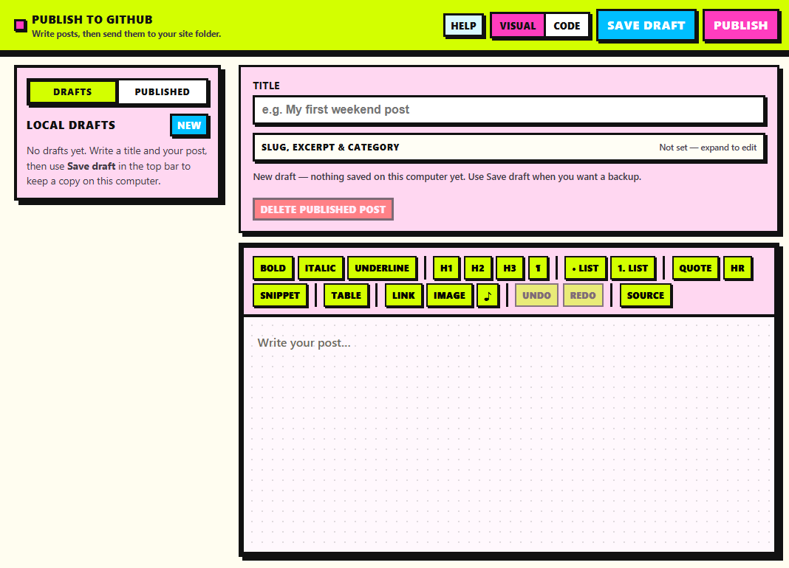

# Pub2Hub
### A blog editor for GitHub Pages

Write a post, add pictures, and publish your own blog. No coding needed.

**[Open the editor →](https://monapdx.github.io/publish-to-github/)**

Pub2Hub is where you write. GitHub stores your posts, and GitHub Pages makes them into a public website.

## 1. Make a home for your blog

You’ll need a [GitHub account](https://github.com/signup).

1. Open [Create a new repository](https://github.com/new). A **repository** is simply a project folder on GitHub.
2. Give it a name, such as **my-blog**.
3. Choose **Public** so you can use GitHub Pages with a free account.
4. Turn on **Add a README** so the repository starts with a file.
5. Click **Create repository**.

Use a new repository for your blog. You don’t need to copy or fork Pub2Hub.

## 2. Create your publishing key

GitHub calls this a **personal access token**. It lets the editor save posts to your repository.

1. Open [Fine-grained personal access tokens](https://github.com/settings/personal-access-tokens) and click **Generate new token**.
2. Name it **Pub2Hub**, choose an expiration date, and select your account as the **Resource owner**.
3. Under **Repository access**, choose **Only select repositories** and select your blog.
4. Under **Repository permissions**, give **Contents** and **Workflows** **Read and write** access. Leave **Metadata** at its automatic read-only setting.
5. Click **Generate token**, then copy it. GitHub only shows it once.

Keep this key private, like a password. Paste it into the editor, never into a post.

[GitHub’s token guide](https://docs.github.com/en/authentication/keeping-your-account-and-data-secure/managing-your-personal-access-tokens)

## 3. Connect the editor

[Open Pub2Hub](https://monapdx.github.io/publish-to-github/) and fill in the welcome screen:

| Field | What to enter |
| --- | --- |
| GitHub username | Your account name, such as `octocat` |
| Repository name | Just the name, such as `my-blog` |
| Branch | Leave as `main` for a new repository |
| GitHub personal access token | The key you just copied |

Click **Save and open editor**.

## 4. Publish your first post

1. Enter a title and write in **Visual** mode. Use the toolbar to format text and add images.
2. Click **Save draft** if you want to keep working later.
3. When you’re ready to share, click **Publish**, then **Publish to GitHub**.

Pub2Hub creates your blog’s pages, design, and publishing instructions automatically.

**Finish this one-time setup on GitHub:**

1. Open your **blog repository** and go to **Settings → Pages**.
2. Under **Build and deployment → Source**, choose **GitHub Actions**.
3. Open the **Actions** tab, select **Deploy blog to GitHub Pages**, and click **Run workflow**. Leave the branch as `main` and confirm.
4. Wait for it to finish successfully, then return to **Settings → Pages** to find your website link.

For a repository called `my-blog`, the address is usually:

`https://YOUR-USERNAME.github.io/my-blog/`

Share that address with readers. Future posts update the site automatically; allow a few minutes for changes to appear.

## Keep writing

- **New post:** Click **New** in the Drafts sidebar.
- **Continue a draft:** Open it under **Drafts**. After your first save, changes autosave while you work.
- **Edit a published post:** Open **Published**, select the post, make changes, and publish again. Keep the same slug (the post’s filename) to update its existing address.
- **Change your connection:** Click **Publish** to edit your GitHub details.
- **More options:** Expand **Slug, excerpt & category** below the title. **Code** mode is optional.

**Drafts stay in this browser on this computer.** Clearing site data removes them. Published posts are saved on GitHub and can be opened again through the editor.

## Need help?

Click **Help** inside the editor.

- **Site not showing?** Check **Settings → Pages** uses **GitHub Actions**, then look for a failed run in the **Actions** tab.
- **Publishing denied?** Check the repository name, token expiration, and the two permissions in step 2.
- **Post saved but site unchanged?** Wait a few minutes, then refresh your website.

Prefer running the editor on Windows? Download this repository using **Code → Download ZIP**, extract it, install [Node.js LTS](https://nodejs.org/), then double-click `install.bat` once and `start.bat` whenever you want to write.

[Get Pub2Hub on Gumroad](https://ashpdx.gumroad.com/l/lvsnmfb)
